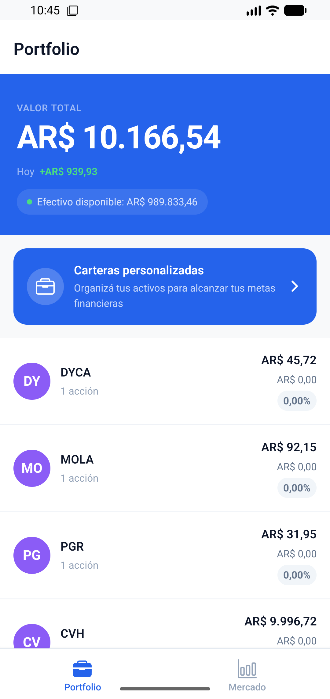
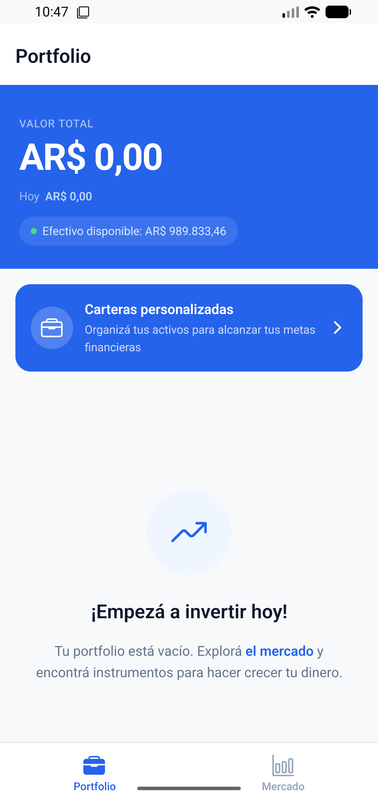

# Funcionalidades — Cocos Challenge

---

## Capturas de pantalla

| Portfolio con posiciones | Portfolio vacío |
|:---:|:---:|
|  |  |

---

## Funcionalidades del challenge

### Mercado

- Listado de instrumentos con ticker, nombre, último precio y retorno del día
- Búsqueda en tiempo real por ticker con debounce de 400 ms

### Portfolio

- Resumen de cartera con valor total y variación del día
- Lista de posiciones con valor de mercado y rendimiento por instrumento

### Órdenes de compra y venta

- Flujo en 4 pasos: selección de acción → formulario → presupuesto → resultado
- Dos modos de ingreso: monto en AR$ o cantidad de títulos, con conversión automática
- "Usar todo": completa el campo con el máximo disponible según contexto (efectivo o títulos)
- Tipo de orden: Mercado o Límite (con campo de precio límite)
- Restricción de venta: el botón Vender se deshabilita si no hay posición en el instrumento
- Validación en tiempo real: bloquea el botón Siguiente si el monto supera el efectivo o las acciones disponibles
- Manejo de errores: errores de usuario (4xx) mostrados en el formulario; errores de sistema (5xx / red) mostrados como banner

---

## Funcionalidades extra

### Carteras personalizadas

- Crear carteras con nombre personalizado, persistidas localmente con AsyncStorage
- Agregar instrumentos a una cartera con la cantidad deseada
- Detalle de cartera: valor total valorizado al precio de mercado actual, lista de allocations con rendimiento individual
- Eliminar instrumentos de una cartera con swipe o selección múltiple
- Renombrar y eliminar carteras

### Mejoras de UX en Portfolio

- Pull-to-refresh para actualizar datos manualmente
- Empty state motivador con link directo a la pantalla de Mercado
- Skeleton screen durante la carga inicial

---

## Tests

El proyecto tiene 76 tests distribuidos en dos tipos:

### Tests unitarios (lógica pura)

| Archivo | Qué cubre |
| ------- | --------- |
| `src/__tests__/calculations.test.ts` | Cálculos de retorno y valor de mercado |
| `src/features/order/__tests__/order-form.test.ts` | `computeUseAllValue` (BUY/SELL × monto/títulos), `isUseAllAvailable`, validación de inputs |

### Tests de componentes (React Native Testing Library)

| Archivo | Componente | Casos cubiertos |
| ------- | ---------- | --------------- |
| `src/features/order/__tests__/SelectStep.test.tsx` | `SelectStep` | Botones Buy/Sell/Cancel, Sell deshabilitado sin posición |
| `src/features/order/__tests__/FormStep.test.tsx` | `FormStep` | Submit deshabilitado, "Usar todo", errores de validación, excede efectivo |
| `src/features/wallets/__tests__/WalletAssetItem.test.tsx` | `WalletAssetItem` | Render de ticker/cantidad/valor, precio de holding, singular/plural |
| `src/features/wallets/__tests__/WalletEmptyContent.test.tsx` | `WalletEmptyContent` | Estado vacío, navegación a add-asset |
| `src/features/wallets/__tests__/WalletAssetList.test.tsx` | `WalletAssetList` | Total valorizado, lista de allocations, navegación |
| `src/features/wallets/__tests__/QuantityInputCard.test.tsx` | `QuantityInputCard` | Cantidad disponible, "Usar todo", error por exceso, hint de precio |
